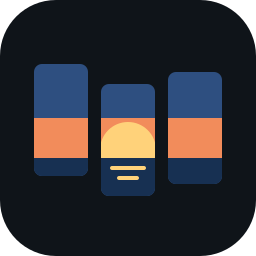
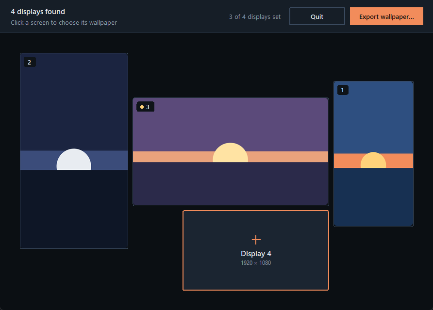
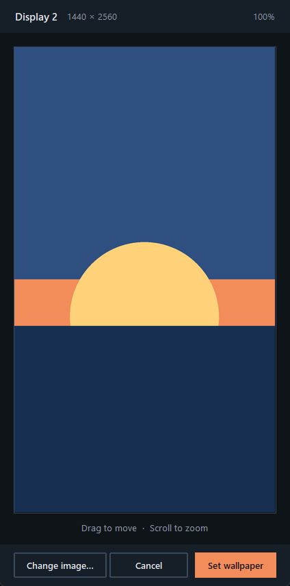

<div align="center">



# Better-Walls

**A different, perfectly cropped wallpaper on every monitor.**
Windows can't do it well. Better-Walls draws your real screens and lets you crop each one.




</div>

## Why

Windows' own settings stretch or tile one image across mixed monitors, and portrait screens, different resolutions or offset displays end up misaligned. Better-Walls works from your **actual monitor layout**: every screen gets its own image, cropped to its exact resolution, then stitched into one spanning wallpaper that lines up across all of them.

## Features

- 🖥️ **Your real layout.** Detects every monitor with its true position, size and orientation, and draws them to scale. The primary display is marked with a gold dot.
- ✂️ **Crop per screen.** A crop window locked to that monitor's exact shape: drag to move, scroll to zoom, with the zoom level shown.
- ⚡ **Applied instantly.** Hit *Set wallpaper* and the desktop updates right away, no extra steps.
- 💾 **Remembers your crops.** Each screen's crop is cached, so reopening the app shows every screen as you left it.
- 📤 **Export the full image.** Save the combined spanning wallpaper as a JPG to keep or share.
- 🎯 **DPI-aware.** Uses real pixel coordinates on high-DPI and mixed-scaling setups.

## How to use

1. **Open Better-Walls.** Your monitors appear in their real arrangement.
2. **Click a screen** and choose an image.
3. **Frame it** in the crop window, then press **Set wallpaper** (or <kbd>Enter</kbd>; <kbd>Esc</kbd> cancels).
4. **Repeat** for the other screens. The toolbar shows how many are set.
5. **Export wallpaper…** saves the combined image if you want a copy.

<p align="center">
  
</p>

## Getting started

**Requirements:** Windows 10 or 11, Python 3.10+.

```bash
git clone https://github.com/snoxlax/Better-Walls
cd Better-Walls
pip install pillow
python wallApp.py
```

### Build the .exe

The included spec builds a single windowed exe with the app icon:

```bash
pip install pyinstaller
pyinstaller --noconfirm wallApp.spec
```

The result is `dist/wallApp.exe`. It runs on its own, no Python needed. Windows SmartScreen may warn about an unsigned app: choose **More info → Run anyway**.

## How it works

| File | Role |
|---|---|
| `wallApp.py` | Main window: toolbar, monitor map, hover and click handling |
| `imageCrop.py` | Crop window: pan, zoom and the crop to the monitor's exact resolution |
| `screenInfo.py` | Monitor detection through the Windows API (positions, work areas, primary display) |
| `wallpaperService.py` | Stitches the crops into one image, sets it as a *span* wallpaper, manages the cache |
| `theme.py` | Shared colours and widget styles, taken from the horizon icon |

- Crops are cached in `%LOCALAPPDATA%\Better-Walls\cache`, one file per monitor, written atomically so a crash can't leave a broken file.
- Monitors to the left of or above the primary one have negative coordinates; the app maps the whole virtual desktop so they land in the right place.
- Resizing uses Lanczos resampling, and EXIF rotation is respected, so photos come out sharp and the right way up.

## Ideas

- Saved presets to switch between whole wallpaper setups
- Drag and drop images onto a screen
- Fit or fill modes in the crop window

## License

MIT
